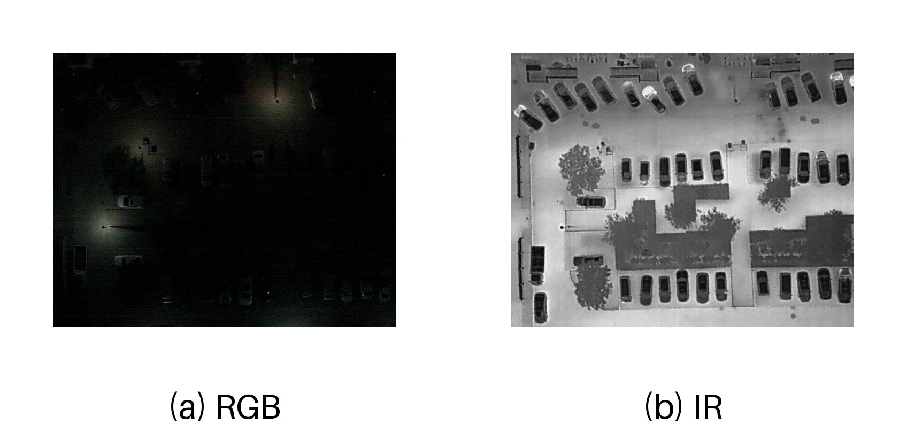

# DroneVehicle RGB/IR example

Validation observation `00001` from [DroneVehicle](https://github.com/VisDrone/DroneVehicle), obtained from the [McCheng mirror](https://huggingface.co/datasets/McCheng/DroneVehicle). [source.json](source.json) records the fixed revision, original files and processing.



```bash
uv run --locked python -m tefed preview --example examples/dronevehicle --output runs/dronevehicle_preview
uv run --locked python -m tefed validate examples/dronevehicle/data_manifest.json --check-files
```

The RGB-side XML contains 15 objects. The original 840×712 image extent and border are retained. IR is a single-channel copy of the original JPEG's three equal intensity channels. [class_map.json](class_map.json) defines this example's class IDs; [class_aliases.json](class_aliases.json) maps the source's freight-car spellings explicitly. Use the trained checkpoint's class order for detection.

## Extract another observation

Use a pair and its RGB-side annotation from your local dataset:

```bash
uv run --locked python scripts/extract_dronevehicle_example.py \
  --rgb /data/DroneVehicle/rgb/ID.jpg --ir /data/DroneVehicle/prepared_ir/ID.png \
  --annotation /data/DroneVehicle/labels/ID.xml --class-map classes.json \
  --class-aliases examples/dronevehicle/class_aliases.json \
  --sample-id ID --client-id client1 --split test --output runs/dronevehicle_example
uv run --locked python -m tefed preview --example runs/dronevehicle_example --output runs/dronevehicle_local_preview
```

Use the same observation in both modalities and the class map from training. The extractor preserves geometry, converts the selected inputs to PNG and records their hashes. It writes `labels.json`, `class_map.json`, a training-compatible `data_manifest.json` and the preview's `manifest.json`. The preview produces RGB/IR display panels and `rgb_ir.png` without a checkpoint.

Prepare any registration or border cropping with the same annotation transform before extraction. See [data preparation](../../docs/data.md) for input types, class IDs and dataset conversion. DroneVehicle training and evaluation use [dronevehicle.toml](../../configs/dronevehicle.toml).
